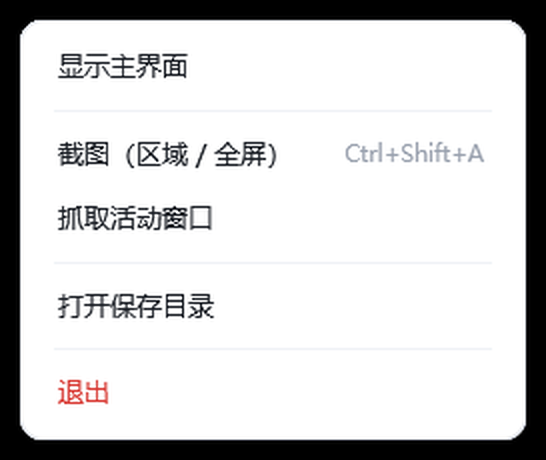

# MdSnap

> 极简、无广告、不联网的 Windows 截图工具 · 单文件免安装

一个自己写的截图工具。起因很简单：常见的截图软件要么弹广告，要么捆绑推广、要么功能堆得让人眼花。这个只做**最常用的那几件事**，然后把它们做顺手。

---

## 特性

- **三种捕捉方式，同一个界面切换** —— 区域拖框 / 活动窗口（鼠标指哪框哪）/ 全屏，都在取景覆盖层里一键切换
- **全局热键** `Ctrl+Shift+A`，随手就截
- **标注编辑器** —— 箭头 / 矩形 / 文字 / 高亮 / 马赛克 / 橡皮擦，带撤销栈（按笔画回滚）
- **按天归档** —— 自动存到 `桌面\20261009\20261009_001.png`，桌面永远不会被截图铺满
- **序号不重号** —— 序号持久化，删掉旧图也继续往下走；超过 999 自动变 4 位
- **捕捉历史** —— 缩略图墙，双击打开 / 右键菜单
- **常驻托盘、无广告、无推广、不联网**
- **单文件免安装** —— 自包含发布，目标机器不需要装 .NET

## 截图

托盘右键菜单：

<p>

</p>

> 主界面、标注编辑器、取景覆盖层的截图待补。

## 关于本项目

作者是机械工程师，本职做机械设计与产品设计，写软件算副业。

这个工具的需求、取舍和验收标准由本人定：为什么用内置自检而不是手工点一遍、
为什么"活动窗口"要跟踪最近一个非本程序的前台窗口、为什么序号必须持久化 ——
这些判断是人做的。**代码由 AI 辅助编写**。

把这一点写出来有两个原因：一是它确实是事实；二是希望读者据此校准预期 ——
如果代码里有不够地道的地方，多半来自这里。反过来，这个项目里我最满意的部分
（那套无界面自检，把"截图 → 存盘 → 逐图元渲染 → 存储规则"全链路跑通）
也正是"人和 AI 都别偷懒"的产物。

## 快速开始

1. 到 [Releases](../../releases) 下载 `MdSnap.exe`
2. 双击运行

   > 程序**没有做代码签名**，首次运行 Windows 会弹 SmartScreen「已保护你的电脑」→ 点 **更多信息** → **仍要运行**。这是所有个人开发者的小工具都会遇到的，不是病毒。
3. 按 `Ctrl+Shift+A` 开始截图

**系统要求**：Windows 10 1809+ 或 Windows 11（x64）

## 快捷键

| 位置 | 按键 | 作用 |
|---|---|---|
| 全局 | `Ctrl+Shift+A` | 打开取景覆盖层（可在设置里换） |
| 取景覆盖层 | 拖拽鼠标 | 框选区域 |
| 取景覆盖层 | `W` / `F` / `R` | 切到 活动窗口 / 全屏 / 区域 |
| 取景覆盖层 | 双击 / `Enter` | 全屏 / 确定 |
| 取景覆盖层 | `Esc` | 取消 |
| 标注编辑器 | `Ctrl+C` / `Ctrl+S` / `Ctrl+Z` / `Esc` | 复制 / 保存 / 撤销 / 关闭 |

## 保存规则

```
<保存根目录>\<当天日期>\<当天日期>_<序号>.<扩展名>
      默认桌面
                    ↓
桌面\20261009\20261009_001.png
桌面\20261009\20261009_002.png
```

- 保存根目录可在「存储」页更改，默认是桌面
- 日期文件夹每天自动新建，跨天自动切换
- 序号**只增不减**：删掉旧图不会重号
- 格式可选 PNG（默认，无损）/ JPG / BMP
- 设置文件：`%LOCALAPPDATA%\MdSnap\settings.json`

## 从源码构建

需要 **.NET 10 SDK**（本项目在 SDK 10.0.300 上开发）。

```bash
git clone https://github.com/mdmodule/MdSnap.git
cd MdSnap
dotnet build                                    # 构建
dotnet publish MdSnap/MdSnap.csproj -c Release -o publish   # 自包含单文件
```

产物：`publish/MdSnap.exe`，约 80MB（自包含 .NET 运行时 + 内嵌字体）。

### 重建界面字体（可选）

仓库里已经放了生成好的子集字体（`MdSnap/Assets/Fonts/*.otf`，各约 4MB），**正常构建不需要这一步**。
只有想改字体子集范围时才需要：

```bash
pip install fonttools brotli
python tools/fetch_font.py     # 下载思源黑体源文件（约 37MB，不进仓库）
python tools/make_font.py      # 子集化 + 按 OFL 要求改名
```

## 项目结构

```
MdSnap/
├── App.xaml(.cs)          程序入口、单实例、--selftest 自检
├── AppConfig.cs           热键预设
├── AppSettings.cs         设置持久化
├── Capture/
│   ├── ScreenCapturer.cs  原生 BitBlt / PrintWindow 抓屏 + 按坐标找窗口
│   ├── ForegroundWatcher.cs  「活动窗口」的目标跟踪
│   ├── CaptureService.cs   捕获流程统一入口
│   └── CaptureFlow.cs      隐藏主界面 → 抓 → 恢复
├── Overlay/               取景覆盖层（区域 / 活动窗口 / 全屏）
├── Editor/                标注编辑器
├── Output/                存盘、历史扫描、打开目录
├── Tray/                  托盘图标 + 热键注册
├── UI/                    主界面、许可窗口、无边框窗口工具
├── Styles/Theme.xaml      设计系统（颜色 / 圆角 / 阴影 / 全部控件样式）
└── Assets/                图标 + 内嵌字体 + 字体许可证
```

**第三方依赖只有一个**：[Hardcodet.NotifyIcon.Wpf](https://github.com/hardcodet/wpf-notifyicon)（托盘图标）。

## 自检

程序内置一个无界面的自检，跑通「截图 → 存盘 → 逐图元渲染 → 主界面 → 存储规则 → 字体」全链路：

```bash
MdSnap.exe --selftest "C:\path\to\_t.png"
```

结果写入 `_t.png.result.txt`：

```
bitmap=3072x1920
trayIcon=OK: 64x64
overlay=OK: 400x300 (期望 400x300) | XAML=OK
editor=OK: 箭头OK(1240px) 矩形OK(2084px) 高亮OK(10377px) | 马赛克OK | 文字OK
eraser_hit=OK: 5/5 图元命中判定正确（命中/不命中双向验证）
eraser_raster=OK: 画白OK 撤销回滚OK 合成变白OK
main_ui=OK        font=OK: 解析到 [MdSnap Sans SC]
storage=OK: 删空后=20261009_009.jpg | 999后=1000
active_window=OK: 任务栏排除OK 桌面排除OK | 坐标找窗: 屏外OK
tray_menu=OK      font_license=OK: 内嵌许可证 4885 字节
```

> 之所以做成内置自检而不是独立测试工程：改动 UI 后跑一遍就知道有没有把功能改坏，比手工点一遍可靠。

## 字体与许可

### 代码

**MIT License** —— 见 [LICENSE](LICENSE)。

### 界面字体

界面字体是 **MdSnap Sans SC**，基于 [思源黑体 (Source Han Sans)](https://github.com/adobe-fonts/source-han-sans) 简体中文版制作的字形子集：

- 按 **SIL Open Font License 1.1** 授权，**允许商用、修改、随软件分发**
- 原始字体版权声明含保留字体名 `Source`，按 OFL 对"修改版"的要求，子集版本**已改名**、不再使用该保留名
- 原始版权声明保留在字体文件内部；许可证全文随程序分发，运行程序后点主界面 **「字体许可」** 可查看

### 图标

程序图标由项目作者制作。

---

## 常见问题

**Q：Windows 弹「已保护你的电脑」/ SmartScreen 警告？**
程序未做代码签名。点「更多信息」→「仍要运行」。

**Q：360 / 杀毒软件报毒或拦截？**
程序用了一个**全局前台窗口钩子**（`SetWinEventHook`）来实现"抓取活动窗口"，这类行为会触发杀软的启发式规则。已经没人会为了截图去写键盘记录器，但规则不懂这个。把程序加入信任区即可。

**Q：按热键没反应？**
默认 `Ctrl+Shift+A` 可能与其它软件冲突（比如截图、录屏工具）。到「热键」页换一个组合，程序会提示是否注册成功。

**Q：截图里出现我自己 / 抓到任务栏？**
「活动窗口」模式抓的是**你上一个真正在用的窗口**（点捕捉时前台窗口已经是 MdSnap 自己了，所以不能取"当前前台"）。用之前先切到目标窗口即可。

**Q：多显示器？**
按虚拟桌面处理，支持负坐标副屏；但作者只有单显示器，多屏场景未充分实测。

---

## 免责声明

本项目是独立开发的工具，与任何商业截图软件**没有关联**。
